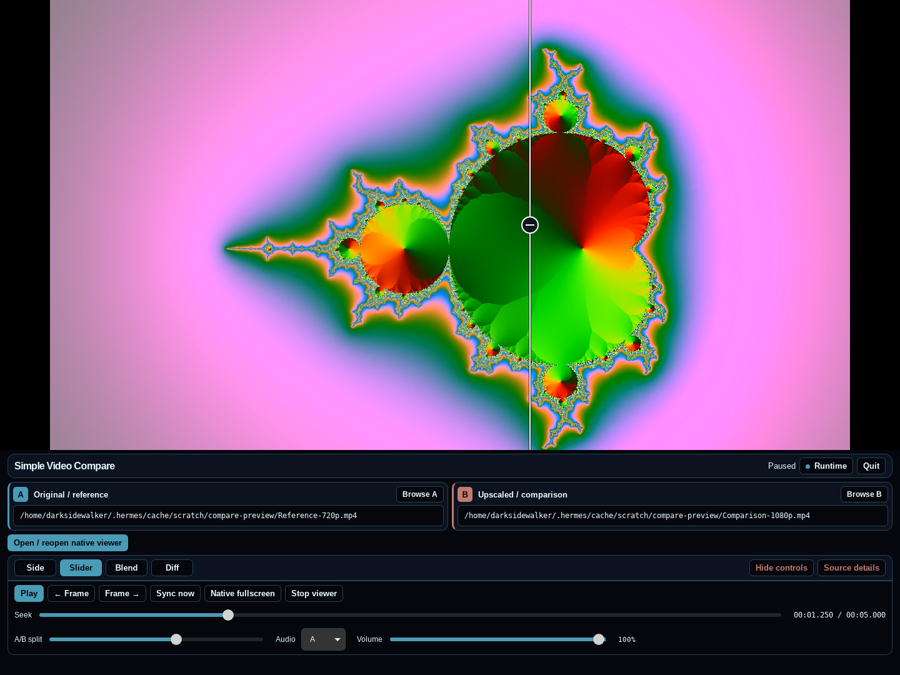

# DaSiWa Simple Video Compare



Compare two local videos with a Rust + React desktop app. Linux embeds libmpv in a native GTK/OpenGL video pane; Windows embeds the libmpv DLL in a native child window above the WebView2 controls. Neither desktop backend launches a separate player. The React interface controls playback without decoding videos in the browser. Original source files are never rewritten.

The preview shows the Linux app with generated demonstration videos.

## Download and start

There are **two desktop binaries**, both for amd64. No separate server, browser-app or `standalone` variant is distributed. macOS is not a release target.

| Platform | Binary | Video runtime |
|---|---|---|
| Linux | [dasiwa-simple-video-compare-linux-amd64](dasiwa-simple-video-compare-linux-amd64) | `libmpv.so.2`, `ffprobe`, GTK3 and WebKitGTK 4.1 |
| Windows | [dasiwa-simple-video-compare-windows-amd64.exe](dasiwa-simple-video-compare-windows-amd64.exe) | 64-bit `libmpv-2.dll`, `ffprobe.exe` and Microsoft Edge WebView2 Runtime |

On Linux:

```fish
chmod +x ./dasiwa-simple-video-compare-linux-amd64
./dasiwa-simple-video-compare-linux-amd64
```

On Windows, launch `dasiwa-simple-video-compare-windows-amd64.exe` and click **Download Windows runtime**. This explicitly downloads the catalog's pinned libmpv and ffprobe archives from GitHub, verifies their SHA-256 checksums and installs them under `%LOCALAPPDATA%\DaSiWa-simple-video-compare\runtime\`. No administrator access, PATH changes or manual DLL copying are needed. Microsoft Edge WebView2 Runtime is still required separately. Nothing is downloaded just by launching the app.

**Runtime → Check runtime** compares the installed version with the catalog included in this app. If the app contains a newer catalog, **Update Windows runtime** installs it after confirmation by clicking the button. This is not a live upstream/nightly update feed. Stop playback before installing; the new runtime is used on the next open. Downloads stage into a separate version directory, so failures do not replace the current runtime. Older versions are retained.

Manual installations remain supported: put a 64-bit `libmpv-2.dll` and any companion DLLs beside the app (or in `lib/`), and put `ffprobe.exe` beside it or on PATH. An `mpv.exe` alone is not the library. Missing or incompatible libraries produce an open error; there is no external-player fallback.

Linux searches for `lib/libmpv.so.2` beside the app, then `libmpv.so.2` beside the app, then the system library; install Linux runtimes with the distribution package manager. Windows prefers the app-managed runtime over adjacent files and PATH. `DAWVC_LIBMPV` overrides the library path on both platforms; use an absolute DLL path on Windows. `DAWVC_FFPROBE` overrides ffprobe. Explicit overrides take priority over the managed runtime. `DAWVC_MPV` is only used by headless/legacy process tests, not desktop playback. No Go sidecar, localhost server or compatibility transcode is needed by the desktop app.

The Linux executable has been exercised with real native rendering. The Windows executable is cross-compiled from the same desktop source. Windows-specific DLL-path/DPI-layout unit tests and shared validation/filter tests also pass under Wine; actual Windows/WebView2 playback, resizing and shutdown have not been verified on Windows.

## Comparing videos

Browse, drop a file onto source A or B, or paste an absolute path. Two selected or dropped files fill A and B in order. A single populated slot also works for ordinary playback. The timeline uses the longer source's duration and holds the shorter source's last frame at its end.

- **Side:** both aligned sources side by side.
- **Slider:** wipe between A and B. On Linux, drag the line or its handle directly over the video, use the A/B split control below, or focus the divider and use the left/right arrow keys.
- **Blend:** mix the two aligned frames.
- **Diff:** show the aligned frame difference.
- **Playback:** play/pause, seek, frame stepping, synchronization, fullscreen, audio A/B/mute and volume.
- **Source details:** original ffprobe metadata and raw JSON, not proxy metadata.

The Linux slider caches the packed A/B frame on the GPU. Dragging changes the displayed regions without rebuilding the video filter, seeking or decoding the paused frame again. It also works while playback continues. Blend and Windows retain the filter-based comparison path; Windows uses the A/B split control below the video rather than Linux's draggable native divider.

When the control desk has focus, Space toggles playback, the left/right arrows seek five seconds, and Shift + arrow steps one frame. Text fields, selectors and buttons keep their normal keyboard behavior.

Comparisons scale/pad B to A's geometry and currently use 8-bit YUV 4:2:0. This is not a bit-exact HDR/high-bit-depth analysis tool. Linux currently uses software decoding with GPU rendering; slider compositing does not remove the cost of decoding large or complex sources. Runtime codec support depends on the installed mpv/FFmpeg build.

## Build

Linux and Windows are the only distributed targets. Node/npm, Rust and the platform's Tauri build dependencies are required. Linux also needs the GTK3/WebKitGTK 4.1 development packages and libmpv for runtime testing.

On Linux:

```fish
./build.sh
```

This rebuilds React and the Linux desktop executable. With `cargo-xwin` and the `x86_64-pc-windows-msvc` Rust target installed, it also cross-compiles the Windows executable. If the cross-toolchain is missing, the script explicitly reports that Windows was skipped. `CARGO_TARGET_DIR` selects a reusable build directory; the default is `.target`.

On Windows, use PowerShell:

```powershell
.\build.ps1
```

This rebuilds React and the native Windows executable. Both scripts publish the same names from the download table; they do not build Go browser/server variants. A running Linux instance is not stopped when its executable is replaced; restart the app to load the new build.

The legacy Go browser implementation and the old root Rust prototype remain source-only. They are not the distributed desktop app. The desktop Rust manifest is `src-tauri/Cargo.toml`.

## Verification

```fish
npm --prefix desktop test
npm --prefix desktop run build
python -m unittest discover -s tests -p '*_test.py'
go test ./...
env CARGO_TARGET_DIR="$PWD/.target" cargo test --manifest-path src-tauri/Cargo.toml
```

The Go tests cover the retained legacy source. Optional Rust integration tests require mpv, ffmpeg, ffprobe and libmpv:

```fish
env DAWVC_TEST_MEDIA=/absolute/path/to/video.webm CARGO_TARGET_DIR="$PWD/.target" cargo test --manifest-path src-tauri/Cargo.toml native::tests -- --include-ignored
```

The optional runtime integration test downloads the actual catalog archives and leaves a verified Windows runtime in the selected scratch directory. It can run on Linux without executing the Windows binaries:

```fish
env DAWVC_RUNTIME_TEST_ROOT=/absolute/path/to/scratch CARGO_TARGET_DIR="$PWD/.target" cargo test --manifest-path src-tauri/Cargo.toml runtime::tests::real_catalog_download -- --ignored --nocapture
```

`desktop/tests/runtime_smoke.py` exercises download consent, progress, failure/retry and update controls with explicit IPC fixtures against a Vite development server; it is UI-contract evidence, not proof of network downloads. The runtime's Rust tests cover real local HTTP transfers, bad hashes, truncation, archive traversal, staging cleanup and atomic version promotion. The Windows test executable and real-download test have also been exercised under Wine, including initialization of the downloaded libmpv DLL and probing a real video with the downloaded ffprobe. This is not real Windows/WebView2 playback verification.

For actual-app checks, launch a dedicated Linux instance with the local inspector enabled, then run either test from another terminal. Use sources longer than four seconds. Each test closes its dedicated instance:

```fish
env DAWVC_RENDER_VERIFY=1 WEBKIT_INSPECTOR_HTTP_SERVER=127.0.0.1:9238 ./dasiwa-simple-video-compare-linux-amd64
# In another terminal:
uv run --no-project --with websocket-client python desktop/tests/native_smoke.py /absolute/path/to/A.mp4 /absolute/path/to/B.webm
# Or, with a new dedicated instance:
uv run --no-project --with websocket-client python desktop/tests/slider_performance.py /absolute/path/to/A.mp4 /absolute/path/to/B.webm
```

The performance test measures control-command round trips, not full mouse-to-monitor latency. Opt-in `GLAREA_SPLIT` logs expose composed center pixels, GPU cache reuse and copy timings; `GLAREA_FRAME` logs include framebuffer hashes and OpenGL errors. Native mouse/pixel tests and two generated 3840×2160 sources have been exercised on Linux, including RTX 5090 rendering. This does not establish performance for every 4K/8K codec or file.

`scripts/package_linux.py` can assemble a local runtime archive from the canonical Linux binary, libmpv, ffprobe and the build host's codec libraries. GTK/WebKitGTK, glibc and GPU drivers remain host requirements. Before redistributing that optional archive, supply the corresponding third-party sources and license notices; it is not a universal Linux release.

## Source layout

- `desktop/`: React controls, frontend model and UI tests.
- `src-tauri/`: native desktop lifecycle, mpv IPC, file selection, Linux GTK/OpenGL renderer, Windows HWND/libmpv renderer and pinned runtime-download catalog/backend.
- `src-tauri/vendor/wry/`: vendored wry with WebKitGTK/Wayland file-drop fixes; third-party licenses are included.
- `tests/`, `scripts/`: desktop build/package checks and optional Linux runtime packaging.
- `cmd/`, `internal/`: retained legacy Go browser app and its tests.
- `assets/`: preview and application artwork.

## License

GNU General Public License, version 3 or any later version. See [LICENSE](LICENSE). Runtime mpv/FFmpeg components and vendored libraries retain their own licenses. See [Windows playback libraries and redistribution requirements](docs/windows-playback.md) for the libmpv decision, libVLC/GStreamer/Media Foundation alternatives and exact-build licensing obligations.
